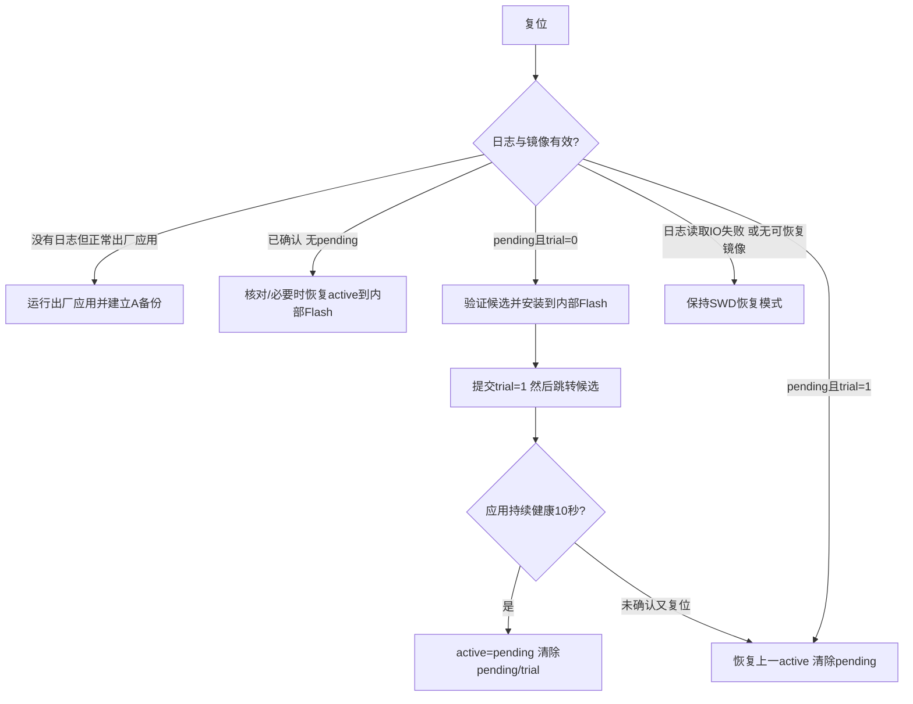

# V3 镜像管理与断电恢复

## 分区

| 存储 | 地址 | 大小/用途 |
|---|---|---|
| 内部 Flash | 08000000..0801FFFF | 128 KiB Bootloader，应用擦写不会覆盖 |
| 内部 Flash | 08020000..081FFFFF | 1920 KiB 运行应用；两槽都链接到此地址 |
| 外部 NOR | 00000000 / 00001000 | 两个4 KiB启动日志扇区 |
| 外部 NOR | 00002000 / 00003000 | 两个4 KiB配置扇区 |
| 外部 NOR A | 00010000..0020FFFF | 2 MiB，首4 KiB头，之后完整应用 |
| 外部 NOR B | 00210000..0040FFFF | 2 MiB，同上 |

这是 **外部 NOR A/B 镜像 + 固定内部执行区**，没有声称从内部 Flash 两个 bank 直接切换执行地址。上限由1920KiB内部应用区决定。剩余 NOR 空间保留。

## 提交顺序与状态

首次运行正常应用持续健康10 s后，将内部应用复制A，读回CRC，写完整镜像头，最后提交active=A、pending=NONE。以后BEGIN只擦写非active槽。DATA按顺序写入并核对读回，END核对长度、整包CRC、复位向量、编译身份后提交镜像头，再提交pending。

镜像头与启动记录均64字节，CRC覆盖commit之前的有效字段，末尾4字节commit单独最后写。启动记录交替写入两个扇区：擦旧扇区、写记录、写commit、读回验证，然后才更新RAM状态；不会先擦除最新有效记录。读取记录失败与“记录不存在/CRC坏”分别处理，日志读取出现I/O错误时保持安装和出厂建档互锁。提交后首读失败会重新读取双份日志，避免把已经持久化的pending当作没提交。

安装前验证外部完整镜像。内部已有相同CRC时避免擦写；否则擦除整个内部应用区，逐1024字节读取NOR并按H743 32字节Flashword编程，最后整区有效长度读回CRC。候选的trial=1记录在跳转之前提交。应用未确认即复位时回滚到旧active。内部安装途中断电，旧active仍保留在NOR；重新启动会从完整NOR重装，跳转前必须通过校验。

最晚45 s未确认时应用停止喂狗；启动失败测试包在RTOS之前挂起，由Bootloader继承的IWDG触发复位。确认依赖所有网关任务/真正tcpip线程心跳、Flash就绪、Ethernet栈初始化，不要求外部传感器、SD或网线全在线。试运行和日志读取异常期间保持运动互锁。

## 内存与跳转

应用向量表位于08020000，编译身份固定在应用偏移400，内容 `IGWID3\0\0`、boardID、version、base；链接器断言向量表不侵入身份区。PC打包与MCU END/Bootloader验证同一身份，拒绝错误板卡、地址或版本不匹配的应用。

AXI SRAM24000000分配普通数据和FreeRTOS heap；DMA专用区30000000的256KiB设为非缓存，UART DMA、ETH描述符/帧缓冲、SDMMC IDMA缓冲均位于此区，32字节对齐。FMC LCD窗口设为Device。D2 SRAM3 `30040000..3004001F` 保留给Bootloader→应用的启动原因交接，不在DMA链接区，带magic/反码/boardID核对。

跳转关闭SysTick与NVIC、释放QSPI/时钟/HAL、清缓存并关闭MPU，设置VTOR、MSP、CONTROL，进入应用Reset_Handler；应用重新设置MPU、时钟与外设。普通应用不直接向Bootloader业务写寄存器；Flash硬件操作由BSP回调隔离。

## 能恢复什么

下载未END时中断：继续旧版，未完成槽无有效新头，重传从0开始。镜像头/启动日志提交中断：只认完整CRC+commit，选择之前有效记录。安装中断：由仍保存的完整NOR镜像重装。未确认新固件：回滚旧active。确认中断：读到完整旧记录则回滚，读到完整新记录则保留新版。参数中断：读取完整旧配置或新配置。

双镜像校验失败或存储硬件故障时进入SWD恢复流程。首次SWD烧录采用读回验证，工厂启动核对编译身份与向量。启动日志使用双扇区交替提交和32位环绕序列号管理。
