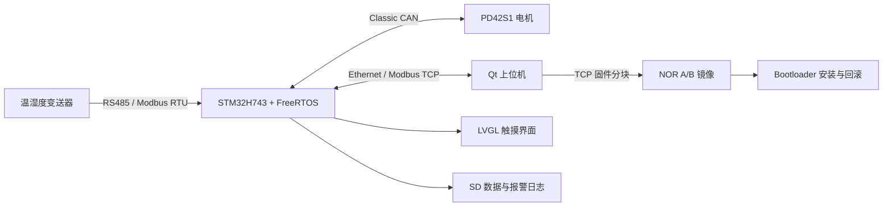
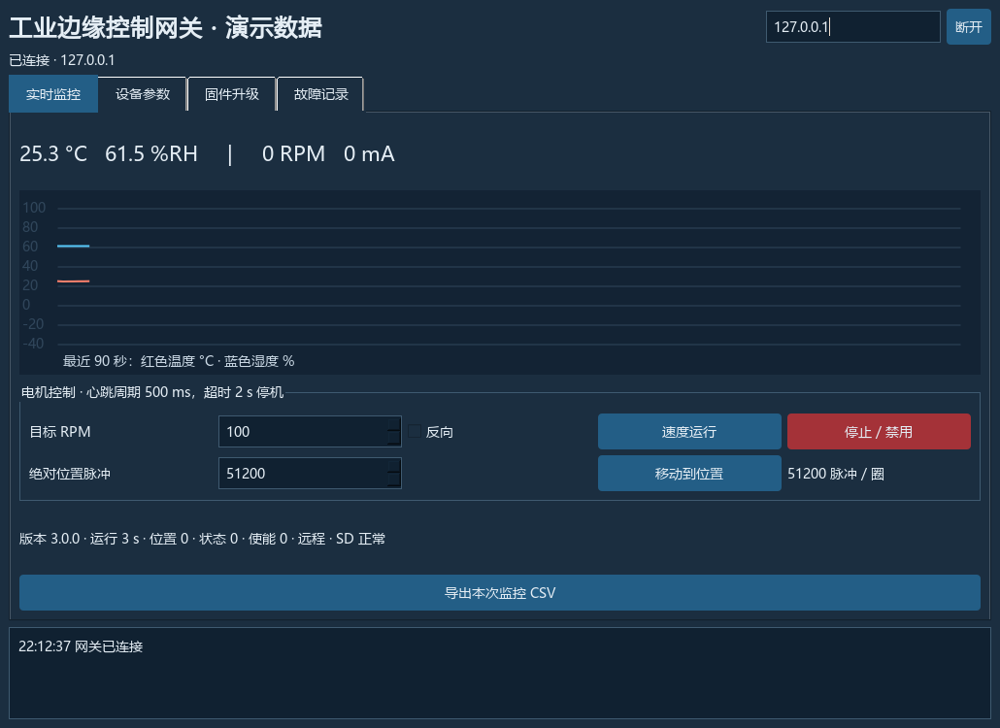

# STM32H743 多协议工业边缘控制网关

基于正点原子阿波罗 STM32H743 开发板，实现 RS485 温湿度采集、Classic CAN 电机控制、原生 Ethernet 网关、本地触摸界面，以及远程固件升级。

`STM32H743` · `FreeRTOS` · `Modbus RTU/TCP` · `LwIP` · `LVGL` · `FatFs` · `Qt/PyQt` · `Bootloader / OTA`

项目采用四层软件架构，将数据采集、设备控制、协议转换、图形交互、日志存储和远程升级集成到统一的工业控制终端中。

## 功能

| 阶段 | 内容 |
|---|---|
| V1 采集与控制 | UART DMA + IDLE、Modbus RTU、PD42S1 专有 CAN 协议、LwIP / RMII、Modbus TCP、统一数据模型与任务队列 |
| V2 监控与维护 | LVGL 看板/趋势/控制/校准/报警，Qt 上位机，SD CSV 日志，Flash 双份配置，断线重连，IWDG |
| V3 升级与恢复 | 独立 Bootloader、TCP 分块传输、CRC32 与镜像身份校验、外部 NOR A/B 镜像、双扇区日志、安装/启动确认/失败回滚 |

A/B 完整镜像保存在外部 NOR，选中的应用安装到内部 Flash 执行。升级过程通过分块传输、CRC32 完整性校验、启动确认和失败回滚管理固件生命周期。

## 架构与数据流



| 目录 | 职责 |
|---|---|
| `Application/` | 网关、传感器、电机、HMI、日志与 OTA 业务 |
| `Middleware/` | Modbus RTU/TCP、PD42S1、升级帧、CRC |
| `System/` | 任务、数据模型、参数与镜像存储 |
| `BSP/` | UART、FDCAN、ETH、QSPI、SDMMC、FMC LCD、触摸 |
| `Bootloader/` | 独立启动固件与可测试的镜像选择策略 |
| `PC_Tools/` | 可运行 PyQt 上位机及 Qt C++ 源码 |
| `Tests/` | 生产 C 原生测试、断电模型、TCP 与固件产物测试 |

## 硬件配置

- STM32H743IIT6、2 MB 内部 Flash，阿波罗开发板；板载 NOR 使用 W25Q256 / 32 MB 配置，以太网使用 LAN8720 RMII 接口。
- 屏幕为 ALIENTEK **2.4/2.8 英寸 16 位并口 TFT + XPT2046**，FMC 接口；显示驱动支持 ILI9341，启动时读取控制器 ID `0x9341`。
- RS485 使用 **USART3 PB10/PB11**。原板 USART2 的 PA2 与 Ethernet MDIO 冲突，需要按 [接线说明](Docs/BRINGUP.md) 改接。
- 电机为 PD42S1 CAN/PLC 版本，使用专有 Classic CAN 协议。
- SHT30 RS485 变送器支持配置地址、波特率、功能码、起始寄存器、数据顺序和换算倍率。

接线、供电与烧录步骤见 [BRINGUP](Docs/BRINGUP.md)。

## 快速开始：先运行电脑演示

Windows、Python 3.10+；首次原生 C 模拟器构建需要联网获取 Zig 0.13.0。

```powershell
python -m venv .venv
.\.venv\Scripts\python.exe -m pip install -r PC_Tools/Qt_Gateway_Manager/requirements.txt
.\.venv\Scripts\python.exe PC_Tools/Qt_Gateway_Manager/main.py --demo
```

也可双击根目录 **打开上位机演示.cmd**。窗口标题标明“演示数据”，数据与电机是模拟的。演示不需要开发板或 STM32 SDK。



连接实板：双击 **打开上位机.cmd**，输入开发板 IP 后点连接。默认 IP `192.168.10.50/24`，Modbus TCP 端口 `502`，维护端口 `5001`。电脑与板卡设置在同一网段，屏幕 Ethernet 显示网线链路状态。详见 [屏幕与上位机操作说明](Docs/USER_GUIDE.md)。

## 获取固件依赖与构建

安装 Git、CMake 3.22+、Ninja、ARM GNU 工具链。Windows 辅助脚本使用 PowerShell，CubeMX/烧录/调试辅助工具使用本机 STM32CubeIDE 安装。

```powershell
python Tools/fetch_dependencies.py
python Tools/fetch_dependencies.py --check
.\Tools\build.ps1 -Mode Release
```

依赖提交固定于 `Vendor/dependencies.lock.json`：STM32CubeH7 v1.12.1、对应 HAL / CMSIS Device、LVGL v8.3.11。下载脚本仅获取构建所需目录；不会下载整套板卡示例或本地手册。

脚本识别 PATH 中的工具和 STM32 VS Code 扩展安装的 ARM/Ninja。非默认安装可设置 `ARM_GCC_DIR`、`IGW_PYTHON`、`CUBE_IDE_DIR`。或者复制 `Tools/local.env.example.ps1` 为 `Tools/local.env.ps1` 后填写自己的路径；此文件不提交 Git。依赖与工具配置见 [DEPENDENCIES](Docs/DEPENDENCIES.md)。

VS Code 打开工程根目录，`Ctrl+Shift+B` 构建 Debug。原生 CMake 方式：

```powershell
cmake --preset Release
cmake --build --preset Release
python Tools/firmware.py package build/Release/Gateway.bin --version 0x00030000
```

| 模式 | 版本 | 用途 |
|---|---|---|
| Debug | 3.0.0 | 调试固件 |
| Release | 3.0.0 | 正常出厂固件 |
| Upgrade | 3.0.1 | 正常 OTA 候选 |
| Failure | 3.0.2 | 故意启动失败，仅用于已有可靠备份后的回滚测试 |

首次烧录使用 Release 或 Debug 的 Bootloader 与 Gateway，地址分别为 `0x08000000`、`0x08020000`。有 ST-Link 且板卡供电正确时可执行 `Tools/program_factory.ps1 -Mode Release`；默认软件复位，不要求 NRST。该命令实际写入固件，具体条件见接线说明。

OTA 选择配套的 `Gateway.bin` 和同目录 `Gateway.json`，不能上传 Bootloader。版本必须递增；后续版本示例：`Tools/build.ps1 -Mode Upgrade -Version 0x00030003`。

## CubeMX 与根目录工程

`Industrial_Gateway.ioc` 是硬件配置。`Tools/cubemx.ps1` 在运行时根据实际路径生成临时脚本，参考外设代码输出到 `CubeGenerated/`，不覆盖分层代码。**完整 V3 由根目录 CMake 构建**，仅构建 Cube 参考代码不包含完整网关。

开发流程使用 CubeMX 配置外设，VS Code 与 CMake 管理分层源码、固件构建、烧录和调试。

## 自动化测试

```powershell
python Tools/test_native.py
python Tests/test_transport.py
# 先分别构建 Debug / Release / Upgrade / Failure，再运行：
python Tests/test_artifacts.py
```

测试覆盖 5,457 项生产 C 检查、1,158 个模拟断电场景、10 项 TCP 集成和 12 项固件产物检查。Debug、Release、Upgrade、Failure 四种 ARM 固件均编译链接通过。结果与复现命令见 [测试报告](Docs/TEST_REPORT.md)。

GitHub Actions 自动执行原生 C 测试、TCP 集成和 PyQt 界面演示，并保存测试报告与界面截图。

控制心跳周期为 500 ms，2 s 租约超时后发送电机禁用命令。网络重连后，由用户重新下发运动指令。

## Qt C++ 版本

上位机提供 PyQt 与 C++17 两套实现，包含实时监控、速度与位置控制、参数配置、固件上传、趋势曲线和 CSV 导出。PyQt 版本通过根目录启动脚本打开；C++ 版本使用 Qt Widgets + Network，源码位于 `PC_Tools/Qt_Gateway_Manager/cpp`，构建命令如下：

```powershell
cmake -S PC_Tools/Qt_Gateway_Manager/cpp -B build/Qt -DCMAKE_PREFIX_PATH="<你的Qt SDK路径>"
cmake --build build/Qt --config Release
```

## 文档与发布

- [接线、供电、烧录与联调](Docs/BRINGUP.md)
- [屏幕与上位机操作](Docs/USER_GUIDE.md)
- [触摸失准恢复](Docs/TOUCH_RECOVERY.md)
- [网络协议与寄存器](Docs/PROTOCOL.md)
- [升级、安装与回滚](Docs/OTA_DESIGN.md)
- [上传 GitHub](Docs/GITHUB.md)

原创代码采用 [MIT](LICENSE)；ST/FatFs 模板派生文件保留原许可，详见 [第三方声明](THIRD_PARTY_NOTICES.md)。源码包不含厂商手册、个人硬件照片、SDK、工具链或编译缓存。
